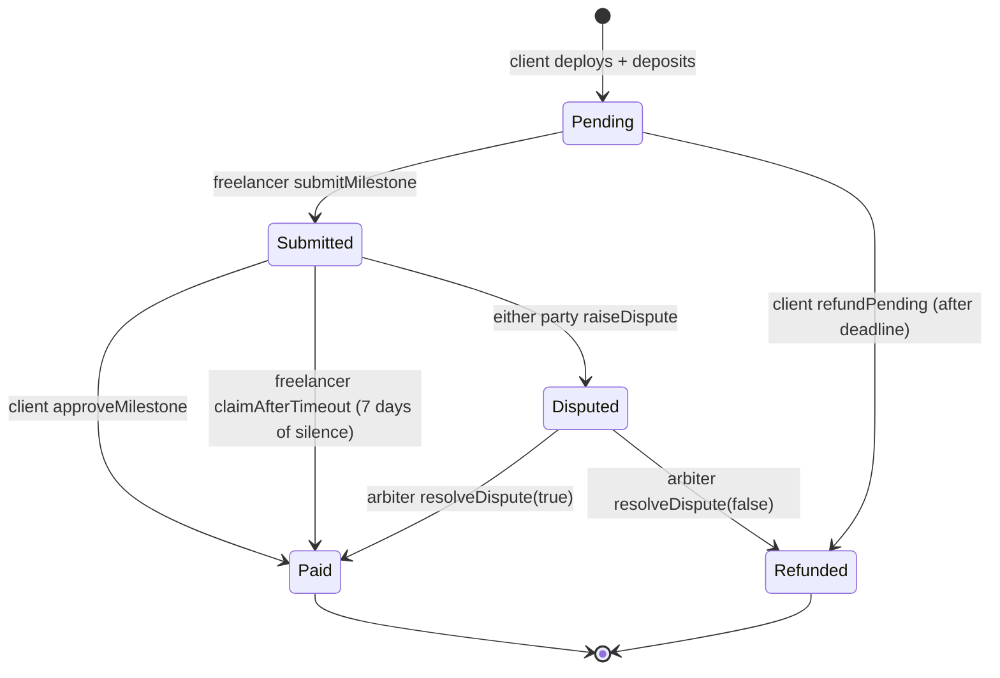

# MilestoneEscrow

**Trustless milestone-based escrow for freelance payments on Ethereum.**

A client and a freelancer who do not trust each other agree on a project split into milestones. The client locks the full payment in a smart contract. Each milestone is paid out only when the client approves it, when the client stays silent past a timeout, or when a neutral arbiter rules on a dispute. Undelivered milestones go back to the client after the deadline. No platform, no platform fee: the rules are code that nobody can change after deployment.

[](https://github.com/Ishaan2510/milestone-escrow/actions/workflows/ci.yml)


---

## Why

Freelance marketplaces solve the "who pays first?" problem by holding the money themselves, charging 10 to 20 percent, and deciding disputes behind closed doors. MilestoneEscrow replaces the middleman with a contract:

- **The money is provably locked.** Anyone can read the contract balance.
- **Payment is automatic.** Approval, timeout or arbitration triggers the transfer; nobody can block it.
- **Silence is not a weapon.** A client who ignores a submission for 7 days loses the right to withhold payment.
- **Ghosting is not a weapon either.** A freelancer who never delivers cannot keep the client's money past the deadline.
- **Every action is a public event**, so the history of the project is an audit log.

## How it works



| Role | Who | Can do |
|---|---|---|
| Client | Deployer (`owner`) | Fund, approve, dispute, refund undelivered milestones, top up |
| Freelancer | Set in constructor | Submit, claim after timeout, dispute |
| Arbiter | Set in constructor | Resolve disputes only |

More detail, sequence diagrams and design decisions: [docs/ARCHITECTURE.md](docs/ARCHITECTURE.md).

## Repository layout

```
src/MilestoneEscrow.sol          The whole system in one Remix-ready file:
                                 Ownable (base) + PayMath (library) + MilestoneEscrow
test/MilestoneEscrow.t.sol       Foundry unit, security and fuzz tests
test/mocks/ReentrantFreelancer   Malicious contract used to prove re-entrancy safety
script/Deploy.s.sol              Deployment script (Anvil or Sepolia)
docs/                            Architecture, demo script, viva prep, change cheat-sheet
.github/workflows/ci.yml         Build + test + gas report on every push
```

## Quick start

### Option A: Remix (no install, used for the live demo)

1. Open <https://remix.ethereum.org>, create `MilestoneEscrow.sol`, paste `src/MilestoneEscrow.sol`.
2. Compile with 0.8.20 or newer.
3. Deploy `MilestoneEscrow` from account 1 with **Value = 3 ether** and arguments
   `freelancer = account 2`, `arbiter = account 3`, `milestoneCount = 3`, `durationDays = 30`.
4. Follow [docs/DEMO.md](docs/DEMO.md) for the full click-by-click walkthrough with expected outputs.

### Option B: Foundry (tests, gas report, scripted deploys)

```bash
# install Foundry once: https://book.getfoundry.sh/getting-started/installation
git clone https://github.com/Ishaan2510/milestone-escrow
cd milestone-escrow
forge install            # pulls forge-std into lib/
forge build
forge test -vvv          # unit + fuzz tests
forge test --gas-report
```

Deploy to a local chain:

```bash
anvil                                   # terminal 1
cp .env.example .env                    # fill FREELANCER and ARBITER with anvil addresses
source .env
forge script script/Deploy.s.sol --rpc-url http://127.0.0.1:8545 --broadcast --private-key <anvil key 0>
```

## Test coverage

| Area | What is proven |
|---|---|
| Constructor | Equal split, remainder to last milestone, all four `require` guards |
| Access control | Every role-restricted function rejects the wrong caller |
| State machine | No double payment, no double submission, no refund of submitted work |
| Time rules | Timeout claim only after 7 days; no submission after deadline; refund only after deadline |
| Disputes | Both arbiter outcomes; a dispute freezes the timeout claim |
| `receive()` | Client top-up lands on the last milestone; strangers are rejected |
| Security | A malicious freelancer contract re-entering on payment is paid exactly once |
| Fuzz | For any deposit and milestone count, the split loses no wei; any mix of payouts and refunds drains the escrow exactly |

## Smart contract concepts demonstrated

State variables, payable constructor, `require`, `view` and `pure` functions, modifiers, events, `enum`, `struct`, dynamic arrays, `mapping`, `msg.sender`, `msg.value`, `block.timestamp`, `immutable` and `constant`, inheritance, libraries, `receive()`, checks-effects-interactions, and safe ether transfer with `call`. Every concept is tagged with a `CONCEPT:` comment in the source.

## Known limitations

- **The contract cannot judge work quality.** It trusts the client's approval or the arbiter's ruling. This is the oracle problem: on-chain code cannot see off-chain reality. The design reduces trust to a single neutral party; it does not remove it.
- **Native ETH only** for now; stablecoin support is on the roadmap.
- **One contract per project.** A factory is on the roadmap.

## Roadmap

- [x] v0.1 Core escrow, full test suite, CI
- [ ] v0.2 Deploy and verify on Sepolia; publish address in this README
- [ ] v0.3 Web front end (ethers.js / wagmi): connect wallet, create escrow, per-role dashboards
- [ ] v0.4 `EscrowFactory`: one-click project creation and an index of all escrows
- [ ] v0.5 ERC-20 payments (USDC), custom milestone splits, platform-optional fee
- [ ] v0.6 Static analysis (Slither) in CI, invariant tests

## Team

- Ishaan Goswami ([@Ishaan2510](https://github.com/Ishaan2510))
- _Teammate name here_

Built as the Blockchain Technology course project at Pandit Deendayal Energy University, then extended.

## License

MIT
