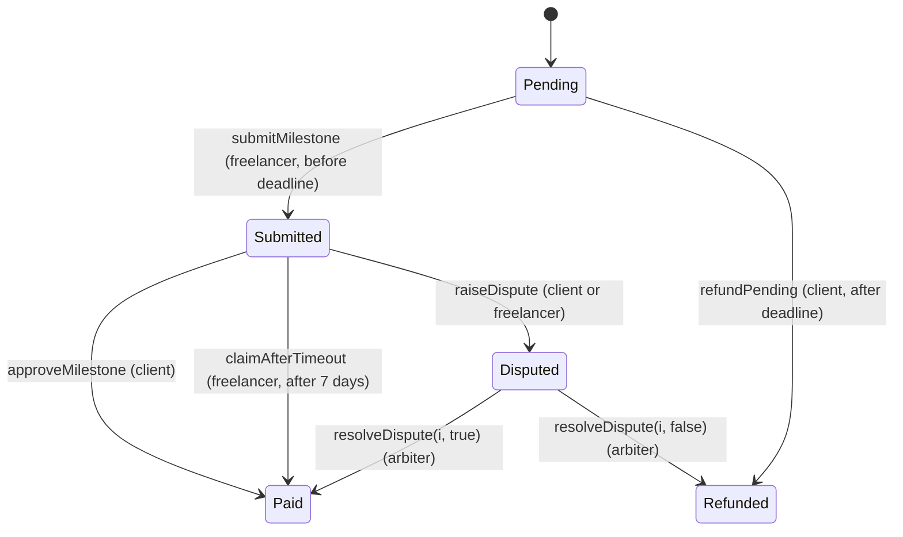
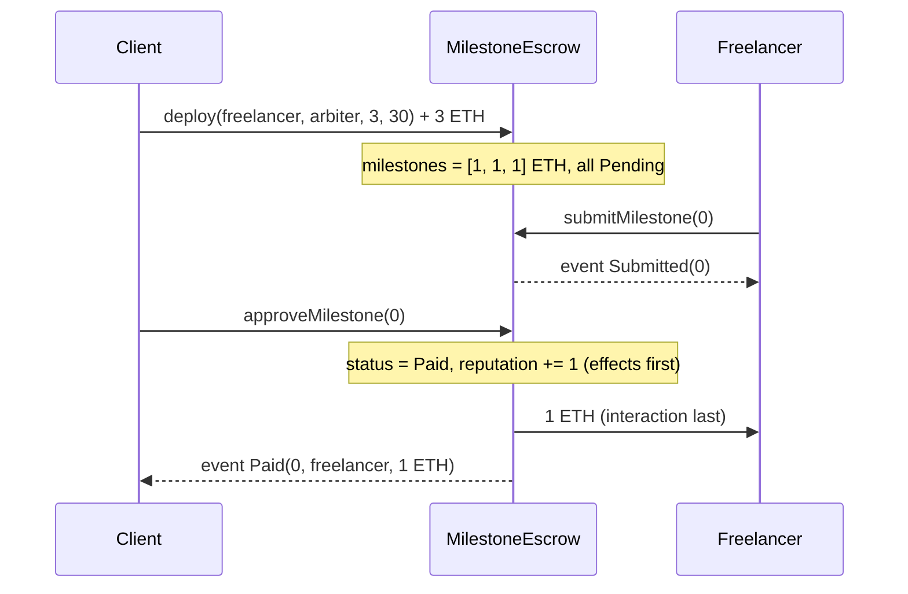

# Architecture

## 1. One file, three pieces

| Piece | Kind | Why it exists | Concept it demonstrates |
|---|---|---|---|
| `Ownable` | Base contract | Remembers the deployer and provides `onlyOwner` | Inheritance, modifiers |
| `PayMath` | Library | Splits the deposit into milestone amounts | Libraries, `pure` functions |
| `MilestoneEscrow is Ownable` | Main contract | Holds the money and enforces the rules | Everything else |

All three live in `src/MilestoneEscrow.sol` so the file can be pasted into Remix as-is.

## 2. Data model

```
enum Status { Pending, Submitted, Paid, Refunded, Disputed }

struct Milestone {
    uint256 amount;       // wei for this milestone
    Status  status;       // current state
    uint256 submittedAt;  // when the freelancer submitted (0 if never)
}

Milestone[] milestones;                 // one entry per milestone
mapping(address => uint256) reputation; // freelancer => milestones paid
```

Fixed parameters are `immutable` (set once in the constructor: `freelancer`, `arbiter`, `projectDeadline`) or `constant` (fixed in source: `TIMEOUT = 7 days`). Both are cheaper to read than normal storage and cannot be changed after deployment.

## 3. State machine (per milestone)



`Paid` and `Refunded` are terminal. Because every money-moving function first checks the current status, and the status is changed before any ether is sent, a milestone can never be paid twice.

## 4. Happy path sequence



## 5. Design decisions

| Decision | Alternative considered | Why this one |
|---|---|---|
| Send ether with `call` and check the result | `transfer` (used in older course slides) | `transfer` forwards only 2300 gas and can break for smart-contract wallets. `call` is the current recommendation; safety comes from checks-effects-interactions instead of the gas limit. |
| One private `_send` function | Transfers scattered in each function | Exactly one place where ether leaves the contract; easy to audit, easy to add a fee. |
| `submitMilestone` blocked after the deadline | Allow late submission | Otherwise the freelancer could race the client's refund. After the deadline, Pending means "not delivered". |
| `receive()` only accepts the client and adds the top-up to the last milestone | Accept anyone's ether | Ether sent by anyone else would be stuck forever. Attaching it to a milestone guarantees every wei is either paid or refunded. |
| `timeLeft` reverts if the milestone is not submitted | Return 0 | 0 would be ambiguous ("claim now" vs "nothing to claim"). Also demonstrates `require` inside a `view`. |
| Equal split with remainder to the last milestone | Custom amounts per milestone | Simplest constructor for the demo. Custom splits are cheat-sheet change #3. |

## 6. Security properties (and how each is tested)

1. **No double payment:** status checks plus effects-before-interactions. Tested by `test_RevertWhen_PaidTwice` and `test_ReentrancyCannotDoublePay`.
2. **Role separation:** modifiers on every privileged function. Tested by the `test_RevertWhen_*` access-control tests.
3. **Conservation of funds:** every wei deposited ends with exactly one of the two parties. Tested by `testFuzz_SplitConservesDeposit` and `testFuzz_EveryWeiEndsWithAParty`.
4. **Liveness for both parties:** the freelancer cannot be stalled by a silent client (timeout), and the client cannot be stalled by a ghosting freelancer (deadline refund).

## 7. Trust assumptions

- The arbiter is honest. A corrupt arbiter can send a disputed milestone to either side, but only a disputed one, and only to the client or the freelancer.
- The client and freelancer agree off-chain on what each milestone means. The contract enforces payment, not quality (the oracle problem).
- `block.timestamp` can be nudged by a validator by a few seconds; irrelevant for a 7-day timeout.
